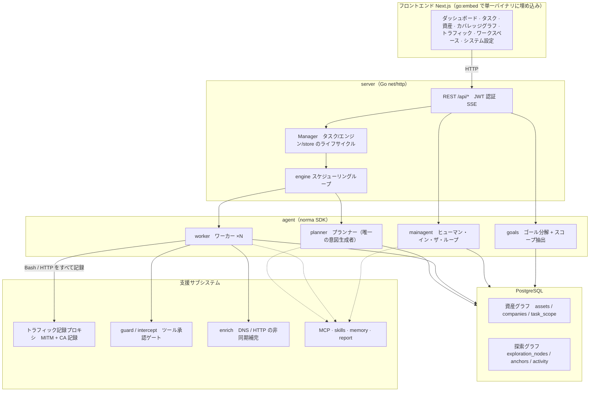
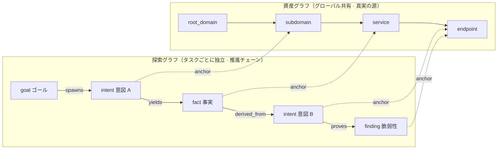
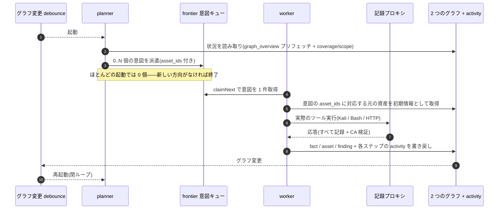
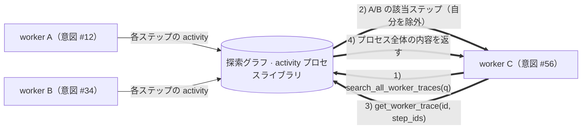
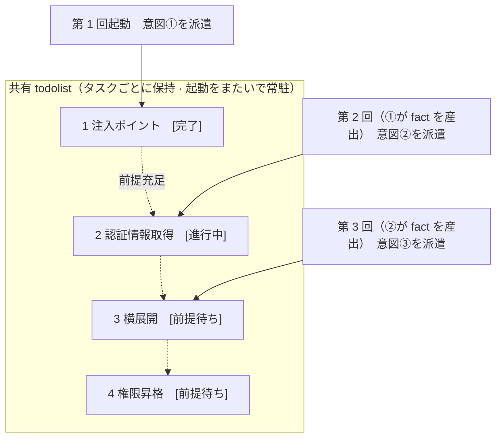

<div align="center">

# ARTEX

AI 自律ペネトレーションテストシステム（Go バックエンド + Next.js フロントエンド）


🌐 **オンライン Demo**： [https://artex-demo.vercel.app/](https://artex-demo.vercel.app/)

📦 **本リポジトリは ARTEX 最終バージョンの純粋なソースバックアップです。Docker デプロイ用のイメージが失効している場合は、AI にローカルビルドさせてください**

</div>

---

## スクリーンショット

> 完全なインタラクションは[オンライン Demo](https://artex-demo.vercel.app/)で確認できます。

| ダッシュボード（概要 / Token 消費 / アクティビティストリーム） | タスク一覧 |
| :---: | :---: |
|  |  |

| タスク · 実行プロセス（セッション / ツール呼び出し） | 探索チェーン |
| :---: | :---: |
|  |  |

| 検出結果 | 資産 |
| :---: | :---: |
|  |  |

| 資産カバレッジグラフ（力学指向レイアウト · テスト済みをハイライト · ノードの折り畳み/展開） |
| :---: |
|  |

| トラフィック記録 | ヒューマン・イン・ザ・ループ対話 |
| :---: | :---: |
|  |  |

| Agent 管理 | LLM 設定 |
| :---: | :---: |
|  |  |

| インターセプト承認 | バックエンドログ |
| :---: | :---: |
|  |  |


---

## 承認記録の詳細

グローバルの「承認記録」、タスク内の「インターセプト承認」、および対話中の承認カードはいずれも展開して詳細を確認できます。表示構造は
[AegisHook の承認詳細コンポーネント](https://github.com/RuoJi6/AegisHook/blob/main/web/src/components/CallDetail.vue)を参考にし、ARTEX のコンポーネントとテーマを踏襲しています：


## 資産同期（ScopeSentry）

[ScopeSentry](https://github.com/Autumn-27/ScopeSentry) から資産データを直接同期でき、重複した収集を省けます：

- 「**資産同期**」ページで ScopeSentry のアドレスと API Key を入力し、データソースに接続する。
- **プロジェクト**または**タスク**単位で、同期する対象と資産タイプ（ドメイン / サブドメイン / IP / ポート / サイト / エンドポイント…）を選択する。
- ワンクリックでインポートし、企業の資産範囲ごとにマージして、そのまま ARTEX の資産グラフに入れ、agent の探索に利用させる。

---

## インストール

> データベース **PostgreSQL** が必要です。探索には **LLM** の設定が必要です（`ANTHROPIC_API_KEY` または `OPENAI_API_KEY`、UI から設定することもできます）。

### 方法一：ワンクリックインストールスクリプト（推奨）

```bash
git clone https://github.com/Autumn-27/ARTEX.git
cd ARTEX
./install.sh
```

スクリプトは：Docker を検出 / 自動インストール → **① すべて Docker** か **② ローカルでビルドして実行** を選択させる：

- **① すべて Docker**：Postgres のパスワードを入力（Enter でランダム）→ `.env` を自動生成 → `docker compose up -d`。
- **② ローカル実行**：データベースを選択（既存に接続 / Docker で起動）→ `config.json` を生成 → `go` で内蔵単一バイナリをビルド → 起動。

インストール後、**http://localhost:8787** を開きます（初回は `/setup` で管理者パスワードを設定）。

### 方法二：Docker Compose（手動）

```bash
git clone https://github.com/Autumn-27/ARTEX.git
cd ARTEX
cp .env.example .env          # POSTGRES_PASSWORD を設定、ANTHROPIC_API_KEY は任意
docker compose up -d          # autumn27/artex イメージ + postgres を取得
# → http://localhost:8787
```

イメージにはよく使うツール（ripgrep/curl/vim/npm/nmap…）が含まれています。`./skills` と `./data` はバインドマウントで永続化されます。

リモート MCP はシステム設定で `http`（Streamable HTTP）または `sse`（旧版 SSE）を選択できます。
旧版 SSE サービスは通常 `GET /sse` でイベントストリームを確立し、サービスが返す
`/message?sessionId=...` で JSON-RPC リクエストを受け取ります。設定時は URL に `/sse` を指定し、
リクエストヘッダは `Authorization=Bearer <token>` の形式で入力します。

### 方法三：ビルド済みバイナリをダウンロード（Releases）

[Releases](https://github.com/Autumn-27/ARTEX/releases) から該当プラットフォームの zip をダウンロードし、解凍すると `artex` + `start.sh`（Windows は `start.bat`）+ `skills/` + `config.example.json` が得られます：

```bash
cp config.example.json config.json   # database 接続を設定
./start.sh                           # → http://localhost:8787
```

> `./artex` を直接実行するのではなく、`start.sh` / `start.bat` で起動してください。これはデーモンスクリプトで、プログラムが終了すると終了コードに応じて再起動するかどうかを決めます。**ページ上の[ワンクリック更新](#方法一ページからワンクリック更新推奨)はこれによって差し替えが行われます**。`./artex` を直接実行していると、更新後に再起動されません。
> バックグラウンドで常駐させる場合：`nohup ./start.sh >artex.log 2>&1 &`。

### 方法四：ソースから単一バイナリをビルド

```bash
# 1) フロントエンドの静的エクスポート
cd web && npm ci && npm run build:static && cd ..
# 2) 埋め込みディレクトリへコピー
cp -r web/out server/webui/dist
# 3) ビルド（-tags embedui を付けたときだけフロントエンドを埋め込む）
CGO_ENABLED=0 go build -tags embedui -o artex ./cmd/artex
./start.sh
```

### 方法五：クロスプラットフォームの Release アーカイブをビルド

`build.sh` はまずフロントエンドをビルドして埋め込み、次に Go linker でデバッグ情報を削除し、リリースファイルを zip に圧縮します。Release モードでは既定で Linux amd64/arm64、macOS amd64/arm64、Windows amd64 の zip パッケージを生成します：

```bash
./build.sh --release
# 成果物：dist/artex-0.3.3-*.zip
```

UPX の自己解凍バイナリは一部の Linux カーネル、仮想化環境、セキュリティポリシーと互換性がない場合があるため、既定では無効です。`ARTEX_TARGETS` でターゲットをカスタマイズできます。ターゲットの実行環境との互換性を確認できている場合は、`--upx` を明示的に渡してバイナリをさらに縮小できます：

```bash
ARTEX_TARGETS=linux/amd64,windows/amd64 ./build.sh --release
./build.sh --target linux/amd64 --upx
```

---

## アップデート / アップグレード

> アップグレードで置き換わるのはプログラムだけで、データには触れません。Postgres のデータボリューム `pgdata`、`./data`（jwt.key / SQLite など）、`./skills` はすべて保持されます。**データベースマイグレーションを手動で実行する必要はありません**——`artex` は起動のたびに `schema.sql` を冪等に再実行します（`ADD COLUMN` / `CREATE INDEX IF NOT EXISTS` を含む）。つまり「再起動がそのままマイグレーション」です。とはいえ、アップグレード前に `./data` とデータベースをバックアップしておくことを推奨します。

### 方法一：ページからワンクリック更新（推奨）

**システム設定**ページ（サイドバーの「システム設定」→ `/system/settings`）の**バージョンと更新**カードで、サーバーにログインすることなく新しいバージョンを確認してインストールできます。

「更新」を押すと：現在のプラットフォームのリリースパッケージをダウンロード → Release の `SHA256SUMS` と照合 → `-h` で新しいバイナリのスモークテスト → `artex.new` として一時保存 → プログラムが終了し、`start.sh` / `start.bat` が再起動して差し替えを完了します。ページは新しいバージョンが立ち上がるまで自動で待機してから更新されます。

- **失敗しても壊れたプログラムは残らない**：検証またはスモークテストが通らなければ一時保存ファイルを破棄し、現在のバージョンで動作を続けます。差し替え後の新版が 3 回連続で起動に失敗した場合は、自動で `artex.old` にロールバックします（失敗したものは `artex.failed` として調査用に残ります）。
- **いつでもロールバック可能**：前のバージョンは `artex.old` として保持され、カードには「前のバージョンにロールバック」があります。ただしデータベース構造はロールバックされません。
- **更新は実行中のタスクを中断します**——更新はすなわち再起動なので、アイドル時に行ってください。
- **開発ビルドには更新を提供しない**：バージョン番号が `dev` の場合や `git describe` にサフィックスが付く場合は無効化され、正式版がローカルデバッグ用バイナリを上書きするのを防ぎます。
- **Docker ではプログラムだけを差し替え、イメージは差し替えない**：イメージ内の playwright / nmap などのツールチェーンは一緒にはアップグレードされず、`docker compose up -d` でコンテナを再作成するとイメージ同梱のバージョンに戻ります。イメージごとアップグレードする場合は `docker compose pull artex && docker compose up -d artex` を使ってください。
- GitHub へのアクセスにプロキシが必要な場合は、同じページで**グローバルプロキシ**を設定すれば、更新処理はそれを経由します。更新は GitHub のドメインからのみダウンロードし、HTTPS を強制します。

### 方法二：ワンクリック更新スクリプト

```bash
cd ARTEX
./update.sh
```

スクリプトはまず任意で `git pull` による最新コードの取得を行い、次に **① Docker 更新** か **② ローカルビルド更新** を選択させます（`install.sh` と対応）：

- **① Docker**：対象イメージの tag を指定可能（Enter で `.env` の `ARTEX_TAG` を踏襲、未設定時は `latest`）→ `docker compose pull` → `docker compose up -d`（新イメージで再起動すれば自動でマイグレーション）。
- **② ローカル**：フロントエンドの静的成果物を再ビルド → `./artex` を再コンパイル（完了後にプロセスを再起動すると反映）。

### 方法三：Docker Compose（手動）

```bash
cd ARTEX
git pull                       # compose / スクリプトを更新（任意）
# バージョン指定：.env に ARTEX_TAG=v0.2.0 を設定。未設定なら latest
docker compose pull artex
docker compose up -d artex     # 新イメージで再起動 → schema を自動マイグレーション
docker image prune -f          # 旧イメージを削除（任意）
```

### 方法四：ビルド済みバイナリ（Releases）

[Releases](https://github.com/Autumn-27/ARTEX/releases) から新バージョンの zip をダウンロードし、旧プロセスを停止してから `artex` と `skills/` を上書きし（あなたの `config.json` と `data/` は保持）、再起動すれば完了です：

```bash
cp -r <展開先ディレクトリ>/skills ./ && cp <展開先ディレクトリ>/artex ./
./start.sh
```

### 方法五：ソースからビルド

```bash
git pull
cd web && npm ci && npm run build:static && cd ..
cp -r web/out server/webui/dist
CGO_ENABLED=0 go build -tags embedui -o artex ./cmd/artex
# ./start.sh を再起動
```

---

## 設定

**データベース**（`config.json`、または環境変数 `ARTEX_PG_DSN` で上書き）：

```json
{
  "database": {
    "host": "127.0.0.1", "port": 5432,
    "user": "artex", "password": "yourpass",
    "dbname": "artex", "sslmode": "disable"
  }
}
```

**LLM**：`export ANTHROPIC_API_KEY=sk-...`（または `OPENAI_API_KEY`）。UI の「LLM 設定」ページから入力することもできます。
任意：`ARTEX_LLM_PROVIDER` / `ARTEX_LLM_MODEL` / `ARTEX_LLM_BASE_URL` / `ARTEX_LLM_PROXY`。

**並列度**：各タスクの work agent 数は「システム設定」で設定します（既定 3）。

**よく使う引数**：`./start.sh -addr :8787 -proxy :8788`（`-addr` はフロントエンド + API、`-proxy` はトラフィック記録プロキシ）。起動スクリプトは引数をそのまま `artex` に渡します。

### リバースプロキシ構成（HTTPS / 443 のみ公開）

フロントエンドと API/SSE はいずれも同じバックエンドポート（既定 `:8787`）から提供され、リアルタイムのアクティビティストリームは既定で**同一オリジン**のアドレスを使うため、**`NEXT_PUBLIC_SSE_BASE` を設定する必要はありません**。外部公開では 443 のみを開放し、8787 は内部ネットワークに置いておけば済みます。

SSE は長接続 + 継続配信であり、リバースプロキシでは**必ずバッファリングを無効化**してください。そうしないとブラウザは接続できてもイベントを受信できません（アクティビティストリームが回り続ける状態になります）。Nginx の例：

```nginx
server {
    listen 443 ssl;
    server_name your.domain.com;
    # ssl_certificate / ssl_certificate_key ...

    location / {
        proxy_pass http://127.0.0.1:8787;
        proxy_set_header Host $host;
        proxy_set_header X-Forwarded-Proto $scheme;

        # SSE の要点：バッファリング無効、長いタイムアウト、HTTP/1.1
        proxy_buffering off;
        proxy_cache off;
        proxy_read_timeout 3600s;
        proxy_http_version 1.1;
        proxy_set_header Connection "";
    }
}
```

> SSE をページとは異なるオリジン（独立したサブドメインなど）経由にする必要がある場合に限り、**ビルド時**に `NEXT_PUBLIC_SSE_BASE` を設定します（この変数は `next build` 時に静的パッケージへ固定されるため、コンテナ実行時に設定しても無効です）。

---


## 開発

### 手動脆弱性再検証

タスク詳細の「再検証」タブでは、このタスクの脆弱性をページングして選択し、過去の結論と証拠を確認し、手動で再検証を開始できます。開始後も現在のタブが保持され、スピナーアイコンと「再検証中」が表示されます。修正を確認すると脆弱性の状態も同期して更新されます。

脆弱性一覧の各行の操作エリアで「再検証」をクリックするか、脆弱性詳細の「脆弱性再検証」エリアで「再検証を開始」をクリックし、任意で修正バージョン、テスト条件や制限を入力すると、システムが独立した再検証 Agent セッションを作成します。開始後も現在のページは保持されます。一覧のフラット表示、タスク別グループ表示、資産ビューはいずれもこの入口に対応しています。再検証の実行中はスピナーアイコンと「再検証中」が表示され、確認したいときはクリックして該当セッションに入り、終了後は「再検証」に戻ります。再検証では元のスキャンタスクを再起動する必要はなく、結論は「依然再現」「修正済み」「確認不可」に分かれます。各回の結論、証拠、セッションリンクは脆弱性詳細に保存されます。

新バージョンのバックエンドは初回起動時に編集可能な「脆弱性再検証」（`retester`）Agent をプリセットします。Agent 管理でプロンプト、LLM、実行予算、ツールを設定できます。既定ではバインディングされた LLM を使用し、未バインドの場合はグローバルで有効な設定を使用します。再検証セッションが正常に完了し、結論が「修正済み」の場合、システムは自動で脆弱性の処置状態を「修正済み」に変更します。実行中、失敗、停止、その他の結論の場合は元の状態を保持します。元の証拠とレポートは常に保持されます。状態のドロップダウンメニューから手動で「修正済み」を選択することもできます。同じ脆弱性を再検証中の場合は既存のセッションを再利用し、停止、失敗、またはサービス再起動後に再度開始できます。

本バージョンの履歴は脆弱性詳細とセッションから確認できます。現時点では脆弱性レポートのエクスポートやタスクアーカイブパッケージには含まれておらず、トラフィックパッケージとも自動関連付けされません。デモモードでは明確にラベル付けされた模擬記録のみを生成し、実際のターゲットへはリクエストしません。

### ローカル実行とテスト

```bash
./dev.sh    # バックエンド(:8787) + トラフィックプロキシ(:8788) + フロントエンド next dev(:5173) → http://localhost:5173
```

- バックエンド：`go run ./cmd/artex`（`-tags embedui` を付けない場合、フロントエンドは埋め込まれない）
- フロントエンド：`cd web && npm run dev`（`/api` はバックエンドへリバースプロキシ、ホットリロードあり）
- テスト：`go test ./...`
- Mock プレビュー（バックエンドなし）：`cd web && NEXT_PUBLIC_MOCK=1 npm run dev`

---

## システム技術アーキテクチャ

ARTEX は **LLM マルチ agent 駆動の自律ペネトレーションテストシステム**です：Go モノリシックバックエンド（Next.js フロントエンドを埋め込み）+ PostgreSQL で構成され、agent 機能は [`norma`](https://github.com/Autumn-27/norma) SDK が提供します（`agentcore` / `tool` / `permission` / `harness` / `memory` / `transcript`）。中核は**双グラフアーキテクチャ**と、それを取り巻く 2 つの自律性メカニズム、すなわち **worker 間のプロセスレベル情報交換**と、**planner が複数ラウンドで共有する todolist による安定的な攻撃チェーン**です。

### 全体レイヤ構成



| レイヤ | 責務 |
| --- | --- |
| **フロントエンド** | Next.js の静的エクスポートを `go:embed` で単一バイナリに埋め込み、タスク/資産/探索チェーン/カバレッジグラフを可視化し、ヒューマン・イン・ザ・ループ対話を提供する |
| **server** | `net/http` ルーティング + JWT 認証 + SSE。`Manager` がタスク、エンジン、DB store のライフサイクルを管理する |
| **engine** | タスクごとに 1 つの `plannerLoop` + N 個の worker goroutine。意図の取得、タイムアウト/一時停止/drain |
| **agent** | goals / planner / worker / mainagent。`ToolSet` が双グラフを LLM ツールとして公開する |
| **db** | 双グラフの Postgres 永続化（pgx）。schema は `go:embed` により起動のたびに冪等にテーブルを作成する |
| **支援** | 記録型 MITM プロキシ、承認ゲート、非同期補完、MCP/スキル/メモリ/レポート |

### 双グラフアーキテクチャ：探索グラフ + 資産グラフ

システムは「**ゴールは何か**」と「**どこまでテストしたか**」を、互いに独立しつつアンカーで結ばれた 2 つのグラフに分けます：

- **資産グラフ（Asset Graph、グローバル共有）**：タスクをまたいで同一の資産真値ストア。ノードは `root_domain / subdomain / ip / service / app / endpoint` で、企業に属します。ドメイン→サブドメイン→サービス→エンドポイントの親子関係と重複排除キーはすべてプログラムが計算し、agent は生の情報を提出するだけです。
- **探索グラフ（Exploration Graph、タスクごとに独立）**：1 回のタスクにおける「思考と前進」のプロセス。ノードは `goal（ゴール）/ intent（意図）/ fact（事実）/ finding（脆弱性）/ hint（ヒント）` で、`spawns / derived_from / yields / proves` などのエッジによって**血縁チェーン**を形成し、「どの方向がどの事実から派生し、何を産出したか」に答えます。
- **2 つのグラフはアンカーで結ばれる**：`exploration_anchors(node_id, asset_id)` が意図/事実/脆弱性を具体的な資産にアンカーします。これにより、「探索方向」からそれがどの資産を対象にしているかを見ることも、「ある資産」から本タスクでどの意図によってテストされ、どのような事実が得られたかを逆引きすることもできます。これは**資産テストカバレッジ**と**資産カバレッジグラフ**（スコープ内資産 + テスト済みハイライト）も支えています。



> 役割分担：**planner** は探索グラフの状況を読み、ゴールを判断し、未カバーの新方向があるときだけ**意図**を frontier に送出します。**worker** は**1 つの意図**を受け取り、実際のツールで実行し、新しい資産/事実/脆弱性を両グラフに書き戻してから停止します。資産グラフは共有される事実であり、探索グラフはタスクごとの前進チェーンです。

### エンジンと意図のライフサイクル（1 回の探索の閉ループ）

エンジンは**イベント駆動**の閉ループです。グラフが変わるたびに planner が起き、planner が意図を送出し、worker が意図を受け取って実行し書き戻し、その書き戻しが次のラウンドをトリガーします——ゴールが証明される（`prove_goal`）まで続きます。



### worker 間のプロセスレベル情報交換

深い探索では、価値のある観察（あるエラー、あるレスポンス、ある隠しパラメータ）が 1 つの worker の**実行プロセス**中に現れても、正式な fact として書かれないことがよくあります。重複作業を避け、チェーン上の worker が互いの肩に乗れるようにするため、worker には**work をまたいでプロセスを検索する**能力があります：

- `search_all_worker_traces(q)`：**本タスクの他の work の実行プロセス**をキーワードで検索する（自分自身の意図のステップは自動的に除外）。ヒットした項目には `intent_id` が付く。
- `list_worker_traces` / `get_worker_trace(intent_id, step_ids=[…])`：まずどの work が実行されたかを見て、次にその work の特定の数ステップの完全な内容を取得して詳細を交換する。

これにより、探索グラフ上にまだ対応する fact がなくても、後続の worker は他者のプロセス中の観察を再利用できます——**情報は worker 間を「実行プロセス」という粒度で流れ**、境界は変わりません（各 worker は依然として自分が受け取った 1 つの意図だけを実行します）。



### planner が複数ラウンドで共有する todolist → 安定的な攻撃チェーン

実際の攻撃チェーンは**前後依存のある多段シーケンス**であることが多く（例：インジェクションポイントの発見 → 認証情報の取得 → 横展開 → 権限昇格）、これらを一度に並列で送出すると破綻します。そこで planner は**タスクごとに保持され、起床をまたいで共有される計画用 ToDo リスト（todolist）**を持ちます：

- planner はイベント駆動であり、グラフが変わるたびに起床しますが、**起床ごとにまったく新しいセッション**です。共有 todolist があるため、一本の直列エクスプロイトチェーンを**1 回記録**し、以降の複数ラウンドで**依存関係に従って段階的に意図を送出**できます。チェーン全体を 1 ラウンドで一括展開する必要はありません。
- 各ラウンドでは「前段のステップが完了し、依存する fact が存在する」次のステップにだけ意図を送出し、進捗に応じてリストを更新します（fact で満たされたステップを完了にマークする）。



こうして攻撃チェーンは「イベント駆動 + ステートレスセッション」という環境でも**安定して前進し、重複せず、順序を誤らない**——これが ARTEX が多段エクスプロイトチェーンを自律的に走り切れる鍵です。

---

## コミュニティ

QR コードをスキャンして WeChat 公式アカウント **SecSentry** をフォローし、公式アカウントのバックエンドでメッセージを送ればグループに参加できます。

<div align="center">


</div>

---

## 参考

https://github.com/oritera/Cairn


## ライセンスと免責事項

### オープンソースライセンス

本プロジェクトは **GNU Affero General Public License v3.0（AGPL-3.0）** でライセンスされています。完全な条項はリポジトリルートの [LICENSE](LICENSE) ファイルを参照してください。

これは、誰でも本プロジェクトを自由に使用、変更、配布できることを意味しますが、**派生作品も同様に AGPL-3.0 でオープンソース化しなければなりません**。特に、**本プロジェクトを変更し、ネットワーク経由（オンラインサービスとしてのデプロイなど）でユーザーに提供する場合、それらのユーザーに対して対応する完全なソースコードも公開しなければなりません**。

> ⚠️ **重要**：オープンソースライセンス自体はソフトウェアの利用目的を制限しません。以下の「利用制限」と「免責事項」は、作者による利用者への追加の取り決めと厳粛な宣言であり、必ず遵守してください。

**ARTEX は個人の学習、コード研究、ローカルでの技術検証にのみ使用するものとし、いかなるオンラインシステムやウェブサイトに対する実際のテストにも使用してはなりません。**

### 許容される利用範囲

- **本プロジェクトのソースコードの閲覧、学習、研究**、および**ローカルの隔離環境**での技術原理の検証にのみ使用できる。
- 個人の学習、学術研究、コードレビューなど、攻撃的でない用途に適しています。

### 禁止事項

- **本ツールを使用して、いかなるウェブサイト、オンラインサービス、ネットワーク接続されたシステムに対してもスキャン、探査、エクスプロイト、攻撃を開始することを厳禁します**（許可の有無、自己所有資産かどうかを問わない）。
- 本ツールを実際のペネトレーションテスト、攻防対抗、本番環境に使用することを厳禁します。
- 本ツールを不法侵入、データ窃取、身代金要求、サービス拒否、その他破壊的・犯罪的な活動に使用することを厳禁します。
- 本ツールを利用して、所在する国/地域の法令に違反する行為を行うことを厳禁します。

### コンプライアンス責任

利用者は、所在する国/地域のサイバーセキュリティ、データ保護、コンピュータ犯罪に関するすべての法令（中国大陸では、これに限定されず「サイバーセキュリティ法」「データセキュリティ法」「個人情報保護法」および関連する司法解釈を含む）を自ら遵守する必要があります。**本ツールの使用によって生じるすべての法的責任と結果は、利用者が自ら負うものとします。**

### 免責事項

本プロジェクトは「現状のまま（AS IS）」で提供され、明示または黙示のいかなる保証も伴いません。作者および貢献者は、本ツールの使用（使用方法が適切かどうかを問わない）によって生じたいかなる直接的・間接的な損失、データ損失、システム損傷、法的紛争についても責任を負いません。**本プロジェクトをダウンロード、インストール、または使用した時点で、あなたは上記のすべての条項を読み、理解し、同意したものとみなされます。**
