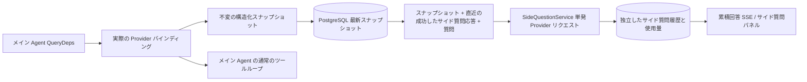

# ARTEX `/btw`

通常のチャット、タスクの MainAgent、および現在のタスク自身の Worker が、独立したサイド質問（傍路質問）をサポートします。メイン入力欄に `/btw 質問` と入力すれば送信でき、空の `/btw` または「サイド質問」ボタンで履歴を開きます。デスクトップでは幅を調整できるサイドバー、モバイルでは Drawer を使います。

サイド回答は送信時点の Agent コンテキストのスナップショットに基づいて生成され、ストリーミング表示、追加質問、停止、クリアに対応します。パネルを閉じる、ページを更新する、SSE が切断されるのいずれもモデルリクエストをキャンセルしません。停止は現在のサイド質問にのみ影響し、クリアはサイド質問をキャンセルしてサイド質問の履歴を削除し、同時にメインコンテキストのスナップショットは保持します。

## 実装の境界

Go、norma v0.3.7、Next.js、既存の Markdown / ResizablePanel / Drawer / AlertDialog コンポーネントを踏襲しています。norma のソースコードは変更せず、サイド質問のために依存関係も追加していません。Planner、他のタスクから継承した Worker、ツール型サブタスクの昇格は今回の範囲外です。

- `capture.go` は `Options.Deps.CallModel / CallModelSync` がマークしたメインループのリクエストのみを対象とします。Provider のデコレータは具体的なモデルの内部、ルーティングプールの外側の選択より後にあるため、実際に選ばれたモデルが記録されます。圧縮や要約のリクエストはスナップショットを上書きしません。
- リクエスト開始時、モデル応答の完了時、実行の終端状態でスナップショットを発行します。生成中の半端な応答は発行しません。ツール呼び出しは norma の `MessagesForAPI` を通じてペアリングを維持し、ツール結果は次回のメインモデルリクエストまたは実行の終端状態でスナップショットに入ります。ストリーミングの中止時は直前の有効な境界を保持します。
- スナップショットは JSON のディープコピーで構造化メッセージ、システムプロンプト、ツール定義、および生成パラメータを保持します。モデルの推論はスナップショットのロックやデータベーストランザクションを保持しません。
- `SideQuestionService` は具体的な Provider を呼び出します。必要なら先にサイド質問の要約を生成し、最終回答は初回のコンテキスト超過かつテキスト/ツール呼び出しをまだ出力していない場合に限り、縮小後のリトライを 1 回だけ許可します。agent session は作成せず、ツール実行器、メイン transcript、アクティビティストリーム、タスクグラフにも接続せず、タスクのモデル切り替えチェーンも経由しません。回答にツール定義を残すのは既存の構造化ツールコンテキストとの互換のためで、要約リクエストにはツールを提供しません。新たに返されたツール呼び出しには実行経路がありません。
- 親セッションごとに実行リクエストは 1 つ、単一のサービスプロセスで最大 4 つ、1 回のタイムアウトは 120 秒です。サイド質問はサービスのライフサイクルの下で独立したキャンセルコンテキストを使います。
- サイド質問リクエストはモデル設定の参照と非機密の身元サマリを保持し、リクエスト時に既存の設定から認証情報を取得します。設定が削除された場合、またはモデル、プロトコル、アドレスなどの身元フィールドが変化した場合は、先にメイン Agent を実行してスナップショットを更新する必要があります。テストは製品の既定モデルを変更しません。

## 永続化と復元

`db/schema.sql` が `side_question_sessions` と `side_question_requests` を自動で作成します。前者は親リソース、最新スナップショット、実行番号、バージョン、クリーンアップバージョンを保存し、後者は質問、累積回答、状態、モデル、スナップショット時刻、使用量、イベントシーケンス番号、ページング用シーケンス番号を保存します。

親セッションのキーには conversation ID、または task ID + exploration ID + intent ID を使います。Worker は再利用可能な実行スロットの名前を使いません。

スナップショットは親セッションごとにマージして書き込み、250 ms ごとに更新し、データベース側で `(run_id, version)` を比較して旧バージョンによる上書きを防ぎます。サイド質問の送信前に、選択したスナップショットを再度保存します。保存に成功したらメモリ上の大きなスナップショットを解放し、失敗時は書き込み待ちのバージョンを保持します。回答の累積内容はストリーミングイベントが届くたびに最大 250 ms 間隔で書き込み、終端状態は即座に保存し、データベースエラー時は回数を限定してリトライします。

サービス起動時、残っていた `running` のリクエストを `interrupted` にマークし、既に永続化された部分回答と使用量は保持し、リクエストを自動で再実行しません。直近に正常保存されたコンテキストは次の質問にそのまま使えます。旧セッションにスナップショットがない場合は、先にメイン Agent を実行する必要があり、UI のアクティビティ記録からコンテキストを再構築することはしません。

クリア操作はクリーンアップバージョンをインクリメントしてリクエストを削除し、条件付き更新で遅延して届いたコールバックが再び書き戻すのを防ぎます。物理的な親リソースの削除は外部キーのカスケードに依存し、Worker の論理削除は同一トランザクションでサイド質問データを削除し、その後に届く遅延スナップショットも拒否します。タスクのアーカイブはまず新規リクエストをブロックし、メインフローの停止を待ち、サイド質問をキャンセルして永続化を待ちます。アーカイブ形式は v3 で、サイド質問テーブルを含まない v1/v2 とも互換性があります。

履歴は完全に保存され、シーケンス番号のカーソルで 1 ページ最大 20 件を返します。モデルリクエストでは直近の成功した質問応答を最大 20 組そのまま再生し、同時に token 予算で再生量を制限します。より古い質問応答は独立したローリング要約として維持します。メインコンテキストが予算を超えた場合は、サイド質問のコピーの古い部分だけを要約し、直近の構造化されたツール呼び出しと結果は保持します。要約、準備の進捗、使用量はまとめてサイド質問の並列度、キャンセル、120 秒タイムアウトの制限対象になります。詳細は[コンテキスト予算とオープンソースの参考](CONTEXT_BUDGET.md)を参照してください。

## HTTP 契約

以下のパスを `{parent}` とし、既存の認証とリソース検証を踏襲します：

- `/api/conversations/{id}`
- `/api/tasks/{id}/chat`
- `/api/tasks/{id}/intents/{iid}`

| リクエスト | レスポンスと動作 |
| --- | --- |
| `GET {parent}/side-questions?before={ordinal}` | `items` は新しい順、独立した `current` 実行状態、`snapshot` のメタ情報、`next_cursor`。カーソルが 0 なら最新ページ / 次ページなし |
| `POST {parent}/side-questions` | JSON `{ "question": "…", "client_request_id": "UUID" }`。新規リクエストは 202 とリクエストオブジェクトを返し、同じ ID と質問なら既存オブジェクトを 200 で返す |
| `DELETE {parent}/side-questions` | 現在の親セッションのサイド質問をキャンセルしてクリアする |
| `GET /api/side-questions/{requestID}/events` | `snapshot` SSE イベント。`id` はインクリメントするシーケンス番号、`data` は完全な累積リクエストオブジェクト。クリア時は `cleared` を送信 |
| `POST /api/side-questions/{requestID}/cancel` | 明示的なキャンセル。終端状態は履歴または SSE から取得可能 |

質問の上限は 4000 文字です。スナップショットなし、モデル設定の変化、同じ親セッションがビジー、冪等 ID の競合は 409 を返し、全体の並列度上限は 429 を返します。各 SSE 接続はまず累積状態を送信し、クライアントが以前に受け取ったテキスト断片には依存しません。フロントエンドはリクエスト ID + シーケンス番号でマージし、親セッションの切り替えやクリアの際に古いコールバックを破棄します。

## 検証と参考

自動チェック、実際のモデル使用、および既知の制限は [VALIDATION.md](VALIDATION.md) を参照してください。

独立リクエストは [Grok CLI side-question.ts（固定コミット）](https://github.com/superagent-ai/grok-cli/blob/fb97af83f06dca873281d60168430f06c8de6324/src/utils/side-question.ts)を、実行の隔離は [OpenCode（固定コミット）](https://github.com/anomalyco/opencode/tree/b3f1a96c6dd7adeb28b36dd11add1998fc84d67b)を参考にしました。ARTEX のコンテキストは norma の構造化メッセージを使用しており、フロントエンドのログからテキストを連結する方式は採用していません。
