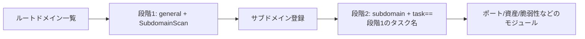

---

## name: scopesentry-mcp
description: ScopeSentry MCP を通じてセキュリティスキャンプラットフォーム（プロジェクト、タスク、テンプレート、資産、ノード）を管理する。ユーザーが ScopeSentry、MCP、API Key、スキャンタスク、資産検索に言及したときに使用する。

# ScopeSentry MCP 使用ガイド

**ScopeSentry インスタンスを導入済み**のユーザー向け。Cursor（またはその他の MCP クライアント）からプラットフォームに接続するため、ローカルのソースコードは不要。

## 1. 準備

### 1.1 サービスにアクセスできることの確認

- 既定の Web インターフェース：`http://<ホスト>`
- MCP エンドポイント：`http://<ホスト>/mcp`（前段にリバースプロキシやフロントエンドプロキシがある場合は、実際の `/mcp` アドレスを基準にする）

### 1.2 API Key の作成

1. ブラウザで ScopeSentry の Web インターフェースにログイン
2. **API Key** 管理ページでキーを作成（または管理者が提供するインターフェースで作成）
3. 返された `ssk_...` 文字列を保存する（**一度しか表示されない**）

### 1.3 Cursor MCP の設定

Cursor → Settings → MCP → サーバーを追加：

```json
{
  "mcpServers": {
    "scopesentry": {
      "url": "http://<あなたのホスト>:8082/mcp",
      "headers": {
        "X-API-Key": "ssk_あなたのキー"
      }
    }
  }
}
```

次の形式も使える：`Authorization: Bearer ssk_あなたのキー`

設定完了後に MCP を再起動するか Cursor を再読み込みし、ツール一覧に `list_projects`、`list_assets` などが現れることを確認する。

---

## 2. ツール一覧


| ツール                     | 用途                |
| ---------------------- | ----------------- |
| `list_projects`        | タグでグループ化されたプロジェクトツリー（プロジェクト ID を含む） |
| `list_projects_data`   | ページングされたプロジェクト一覧。名前で検索可能     |
| `get_project`          | プロジェクトの詳細              |
| `create_project`       | プロジェクトの新規作成              |
| `list_tasks`           | スキャンタスク一覧            |
| `get_task`             | タスクの詳細              |
| `list_scan_templates`  | スキャンテンプレート一覧            |
| `get_scan_template`    | テンプレートの詳細              |
| `list_plugin_modules`  | スキャンパイプラインのモジュール名          |
| `list_plugins`         | 利用可能なプラグイン（hash、既定パラメータを含む） |
| `create_scan_template` | スキャンテンプレートの作成            |
| `create_scan_task`     | スキャンタスクの作成            |
| `list_assets`          | 各種資産の検索（ページングされた一覧）       |
| `count_assets`         | 資産数の集計（`/api/assets/common/total`） |
| `get_asset_detail`     | 資産または脆弱性の詳細           |
| `add_asset_tag`        | 資産へのタグ追加           |
| `list_nodes`           | スキャンノード一覧            |


各ツールのパラメータは MCP のツール記述（schema）を基準とする。`list_assets` / `count_assets` の search、filter の構文は共通なので、資産を検索する前に `list_assets` の description を読んでおくとよい。

「合計何件か」を知りたいときは `count_assets`（Web のページング総数インターフェースに対応）を使い、総数を数えるために `list_assets` で何度もページをめくる必要はない。

---

## 3. よくあるワークフロー

### 3.1 プロジェクト単位で資産を検索

ユーザーやコンテキストに**すでにプロジェクト条件がある**場合は、`filter.project` を付けて範囲を絞り、プロジェクトをまたいだデータが多すぎてレスポンスが遅くなるのを避ける。明確なプロジェクトがなければ、プロジェクトの絞り込みを必須とはしない。

1. `list_projects` または `list_projects_data` で対象プロジェクトの **ObjectID**（`id` / `children[].value`）を取得
2. `list_assets` に `filter.project` を渡す（**必ず ID を指定し、プロジェクトの中国語名を書いてはならない**）

```json
{
  "asset_type": "asset",
  "pageIndex": 1,
  "pageSize": 20,
  "search": "domain=^example.com",
  "filter": {
    "project": ["<プロジェクトObjectID>"]
  }
}
```

### 3.2 スキャンタスクの作成

1. `list_nodes` でオンラインノードの名前を取得
2. `list_scan_templates` または `create_scan_template` でテンプレートの **ObjectID** を取得
3. `create_scan_task`：`name`、`node` は必須。`template` にはテンプレート ID を入れる（テンプレート名は不可）

**ターゲットソース `targetSource`（Web 側と同一）：**

| targetSource | 説明 | 必須パラメータ |
| --- | --- | --- |
| `general` | ターゲットを直接入力 | `target` |
| `project` | プロジェクトからターゲットを読み込む | `project`（プロジェクト ObjectID の配列） |
| `asset` | Web 資産ライブラリから検索 | `search`。任意で `project`、`filter`、`targetNumber` |
| `RootDomain` | ルートドメインライブラリから検索 | `search`。任意で `project`、`filter`、`targetNumber` |
| `subdomain` | サブドメインライブラリから検索 | `search`。任意で `project`、`filter`、`targetNumber` |
| `UrlScan` | URL スキャン結果から検索 | `search`。任意で `project`、`filter`、`targetNumber` |
| `*Source`（例 `subdomainSource`） | 資産ページの「選択/検索」から作成 | `targetTp=search` のときは `search`。`targetTp=select` のときは `targetIds` |

**例 — ルートドメインを直接スキャン：**

```json
{
  "name": "example-サブドメイン収集",
  "node": ["node-1"],
  "template": "<テンプレートObjectID>",
  "targetSource": "general",
  "target": "example.com\nfoo.com",
  "project": ["<プロジェクトObjectID>"]
}
```

**例 — サブドメインライブラリから続けてスキャン（前のタスク名で絞り込み）：**

```json
{
  "name": "example-ポートと脆弱性",
  "node": ["node-1"],
  "template": "<後続モジュールのテンプレートObjectID>",
  "targetSource": "subdomain",
  "search": "task==\"example-サブドメイン収集\"",
  "project": ["<プロジェクトObjectID>"]
}
```

### 3.3 ルートドメインの完全な情報収集（2 段階を推奨）

入力が**ルートドメイン**で、**完全な情報収集**を行いたい場合は、1 回で全パイプラインを走らせず、2 回のスキャンに分けることを推奨する。

**理由：** 分散タスクは**単一のターゲット**単位で配信される。ルートドメインをターゲットにすると、あるノードがそのルートドメインを割り当てられた後、そのノードでスキャンされたサブドメインも同じノードで後続モジュールを実行し続けるため、負荷が偏りやすく、遅くなり、エラーも起きやすくなる。

**ベストプラクティス：**

1. **第 1 段階 — サブドメイン収集のみ**
   - `targetSource`: `general`
   - `target`: すべてのルートドメイン（複数行）
   - テンプレート：`SubdomainScan`、`SubdomainSecurity` のみ有効化（サブドメインスキャン + サブドメイン乗っ取り）
   - `get_task` でタスクの完了を待つ

2. **第 2 段階 — 後続モジュール**
   - `targetSource`: `subdomain`
   - `search`: `task=="<第 1 段階のタスク名>"`（タスク名の完全一致）
   - 任意で `project` を指定して範囲を絞る
   - テンプレート：ポートスキャン、資産マッピング、脆弱性スキャンなど（SubdomainScan は含めなくてもよい）
   - サブドメインが独立したターゲットとして各ノードへ配信されるため、並列効率が高い

Web インターフェースの「サブドメイン」資産ページでタスク名により絞り込み、「サブドメインからタスクを作成」を使っても同じ結果が得られる。



### 3.4 スキャンテンプレートの作成

1. `list_plugin_modules` → モジュール名の一覧
2. `list_plugins`（`module` で絞り込み可能）→ 各プラグインの `hash` と既定の `parameter`
3. `create_scan_template`：`modules` で「モジュール → プラグイン hash の配列」を指定

---

## 4. 資産検索（`list_assets` / `count_assets`）

`count_assets` と `list_assets` は同じ `asset_type`、`search`、`filter` を使い、`{ "total": N }` を返す。Web 側の `/api/assets/common/total` に対応する。

```json
{
  "asset_type": "subdomain",
  "search": "task==\"あるタスク名\"",
  "filter": {"project": ["<プロジェクトObjectID>"]}
}
```

**パフォーマンスの推奨（`list_assets` / `count_assets` 共通）：** プロジェクト条件がある場合は `filter.project` を優先して範囲を絞る。`search` ではインデックス済みフィールドに対してできるだけ `==` の完全一致か `^` の前方一致（[4.3](#43-search-検索式)参照）を使い、大範囲の `=` 曖昧検索でレスポンスが遅くなるのを避ける。プロジェクトのコンテキストがない場合はプロジェクトの絞り込みを必須としない。

`filter.project` に対応する型は [4.4](#44-filter-による完全一致フィルタ) の表を参照。

### 4.1 資産タイプ `asset_type`

`asset`、`RootDomain`、`subdomain`、`app`、`mp`、`UrlScan`、`SensitiveResult`、`DirScanResult`、`crawler`、`vulnerability`、`PageMonitoring`、`IPAsset`、`SubdomainTakerResult`

別名の例：`web`→asset、`vuln`→vulnerability、`ip`→IPAsset、`url`→UrlScan

### 4.2 パラメータの説明


| パラメータ                       | 説明                                      |
| ------------------------ | --------------------------------------- |
| `pageIndex` / `pageSize` | ページング。既定 1 / 20                            |
| `search`                 | 検索式（次節参照）                              |
| `filter`                 | 完全一致フィルタ JSON（次節参照）                          |
| `sort`                   | UrlScan、DirScanResult のみ `length` による並び替えに対応 |
| `sid`                    | SensitiveResult のみ：機密ルール名                |


`search` と `filter` は**同時に使用できる**。

### 4.3 search 検索式

独自 DSL（**SQL ではない**）：


| 演算子  | 意味   | インデックス | 例                          |
| ---- | ---- | ---- | --------------------------- |
| `=`  | 曖昧一致（regex） | インデックス不使用 | `domain=example`            |
| `==` | 完全一致（全等） | **インデックスを使用** | `port==443`                 |
| `!=` | 除外   | — | `port!="80"`                |
| `&&` | かつ    | — | `domain==example.com && port==443` |
| `||` | または    | — | `title=admin || body=login` |


**インデックスと演算子：** `domain`、`ip`、`port`、`title` などのフィールドにはインデックスが張られているが、インデックスが使えるのは **`==` の完全一致**または**値が `^` で始まる前方一致**（例 `domain=^example.com`）のみ。**`=` は regex の曖昧一致に変換され、インデックスを使えない**ため、データ量が多いと遅くなりやすい。

**すべての型で共通の search フィールド：** `tag`、`task`（タスク名）、`rootDomain`

**project は search に書けない**（無効、または `&&` と組み合わせるとエラーになる）。プロジェクトで絞る場合は `filter.project` を使う。

**各型でよく使う search フィールド：**


| asset_type           | フィールド                                                                                  |
| -------------------- | ----------------------------------------------------------------------------------- |
| asset                | domain, ip, port, service, app, title, statuscode, icon, banner, type, body, header |
| RootDomain           | domain, icp, company                                                                |
| subdomain            | domain, ip, type, value                                                             |
| app                  | name, icp, company, category, description, url, apk                                 |
| mp                   | name, icp, company, category, description, url                                      |
| UrlScan              | url, input, source, resultId, type                                                  |
| SensitiveResult      | url, sname, body, info, md5                                                         |
| DirScanResult        | url, statuscode, redirect, length                                                   |
| vulnerability        | url, vulname, matched, request, response, level                                     |
| crawler              | url, method, body, resultId                                                         |
| PageMonitoring       | url, hash, diff, response                                                           |
| IPAsset              | ip, domain, port, service, webServer, app                                           |
| SubdomainTakerResult | domain, value, type, response                                                       |


**search の例：**

- `domain==www.example.com && port==443`（完全一致、インデックスを使用）
- `domain=^example.com`（前方一致、インデックスを使用）
- `ip==192.168.1.1`
- `task=="あるタスク名"`
- `level==high`（vulnerability）
- `statuscode==200`（DirScanResult）

曖昧な部分一致が必要なときだけ `=` を使う。例 `title=admin`（インデックス不使用のため、プロジェクトなどの条件と組み合わせて範囲を絞るとよい）。

### 4.4 filter による完全一致フィルタ

JSON オブジェクト：同じ key に複数の値があれば **OR**、異なる key 間は **AND**。

**プロジェクト条件がある場合は `project` を優先：** ユーザーやコンテキストでプロジェクトが明確であり、asset_type が `project` に対応していれば、範囲を絞るために付けるべき。プロジェクト情報がなければ必須としない。


| filter key   | 意味       | 値の説明                                                     |
| ------------ | -------- | -------------------------------------------------------- |
| `project`    | 所属プロジェクト     | **ObjectID**。`list_projects` / `list_projects_data` で取得 |
| `task`       | 由来タスク     | **タスク名**。`list_tasks` の `name`                         |
| `port`       | ポート       | 例 `"443"`                                                |
| `service`    | サービス/プロトコル    | 例 `"https"`                                              |
| `app`        | アプリケーションフィンガープリント     | 例 `"Nginx"`                                              |
| `icon`       | アイコン hash  |                                                          |
| `statuscode` | HTTP ステータスコード | 主に asset で使用                                               |
| `status`     | ステータス       | UrlScan/DirScan の HTTP コード。脆弱性/機密情報の処理状態                       |
| `level`      | 脆弱性レベル     | critical / high / medium / low / info                    |
| `type`       | タイプ       | 例：サブドメインのレコードタイプ A、CNAME                                         |
| `color`      | 機密ルールの色   | SensitiveResult                                          |
| `sname`      | 機密ルール名    | SensitiveResult                                          |
| `tags`       | タグ       |                                                          |


**各型で使用可能な filter key：**


| asset_type                            | filter key                                                      |
| ------------------------------------- | --------------------------------------------------------------- |
| asset                                 | project, port, service, app, icon, statuscode, type, task, tags |
| RootDomain                            | project, tags                                                   |
| subdomain                             | project, type, task, tags                                       |
| app / mp                              | project, tags                                                   |
| UrlScan                               | status, tags                                                    |
| DirScanResult                         | status, tags                                                    |
| SensitiveResult                       | status, color, sname, tags                                      |
| crawler                               | project, task, tags                                             |
| vulnerability                         | project, level, status, task, tags                              |
| PageMonitoring / SubdomainTakerResult | tags                                                            |
| IPAsset                               | project, port, service, app                                     |


**filter の例：**

```json
{"project": ["<プロジェクトObjectID>"], "port": ["443"]}
```

**組み合わせクエリの例：**

```json
{
  "asset_type": "asset",
  "search": "domain=^baidu && port==443",
  "filter": {"project": ["<プロジェクトObjectID>"]},
  "pageIndex": 1,
  "pageSize": 10
}
```

**注意：**

- プロジェクト条件がある場合は `filter.project` を優先して付ける（対応している場合）。プロジェクトのコンテキストがなければ必須ではない
- `filter.project` にプロジェクトの表示名を入れない
- 既知の値には `==`、前方一致には `^` を使う。大きなテーブルで `=` の曖昧一致を乱用しない
- UrlScan の HTTP ステータスは `filter.status`。DirScanResult は search で `statuscode==200` が使える
- SensitiveResult はルール名で：`search` なら `sname=ルール名`、または `filter.sname`

### 4.5 並び替え sort

**UrlScan**、**DirScanResult** のみ対応：

```json
{"length": "ascending"}
```

その他の型では `sort` は無視され、時刻による既定の並び順になる。

---

## 5. スキャンテンプレートのモジュール名

`TargetHandler`、`SubdomainScan`、`SubdomainSecurity`、`PortScanPreparation`、`PortScan`、`PortFingerprint`、`AssetMapping`、`AssetHandle`、`URLScan`、`WebCrawler`、`URLSecurity`、`DirScan`、`VulnerabilityScan`、`PassiveScan`

---

## 6. トラブルシューティング


| 現象        | 対処                                                 |
| --------- | -------------------------------------------------- |
| MCP にツールがない   | URL、API Key、ScopeSentry が動作しているか確認                    |
| 401 / 403 | API Key を再作成するか交換する                                    |
| 資産が見つからない     | `filter.project` が ObjectID であることを確認。search に project を書かない |
| テンプレート/タスクの作成に失敗 | `template` はテンプレート ObjectID でなければならない。`node` にはオンラインノード名を入れる            |
| クエリが遅い/止まる   | プロジェクトがある場合は `filter.project` を付ける。search ではインデックス済みフィールドに `==` か `^` 前方一致を使い、`=` を減らす。`pageSize` を小さくする |


---

